# Assignment 4. Forms and Validation

Name: Kapessova Danaiym

Group: IT-2513

## Part 1. Basic HTML Forms

### Task 0. Simple Contact Form

I made a simple contact form with name, email, message and submit button. Every field has a label.

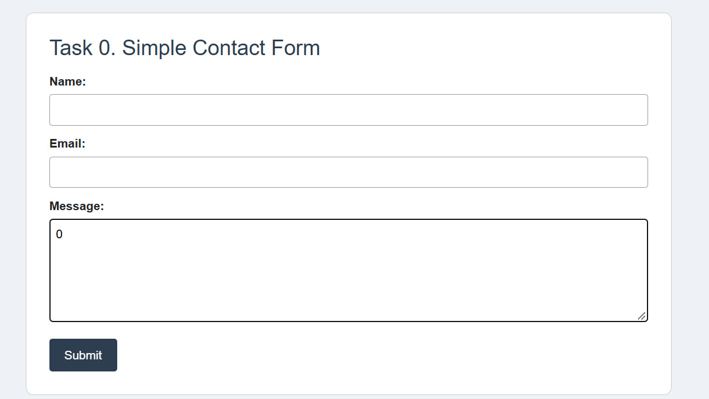

### Task 1. Form with HTML5 Validation

I added required, type email, minlength and maxlength to the fields. When the field is empty or email is wrong, the browser shows an error and the form is not sent.

Empty field:

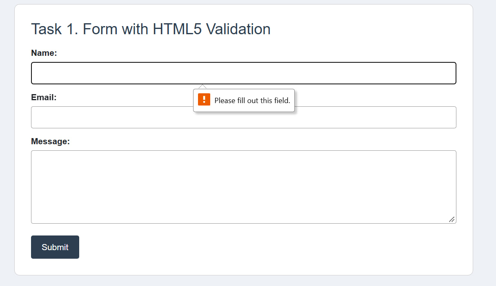

Wrong email:

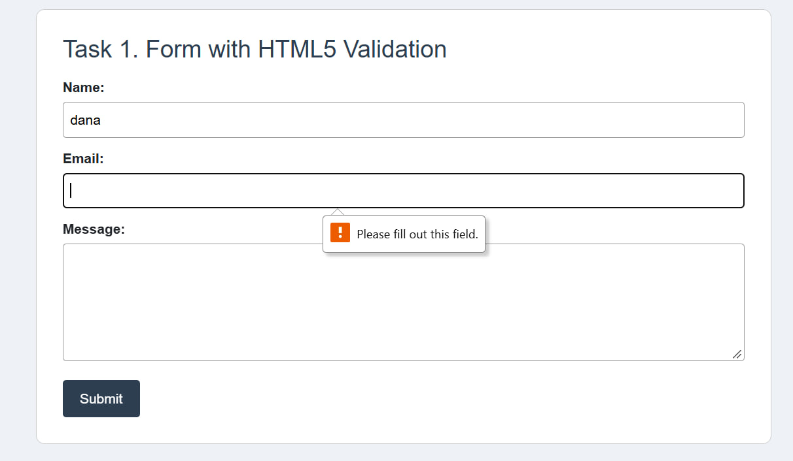

## Part 2. Bootstrap Forms

### Task 2. Bootstrap Form Styling

I made the same contact form with Bootstrap classes form-control, form-label and btn. I used Bootstrap grid (row and col-md-6) so name and email are in one row on computer and one under another on phone. I also added placeholders and helper text.

Desktop:

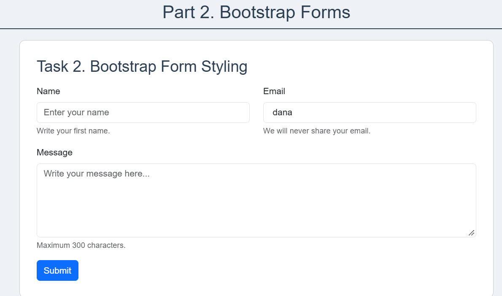

Mobile:

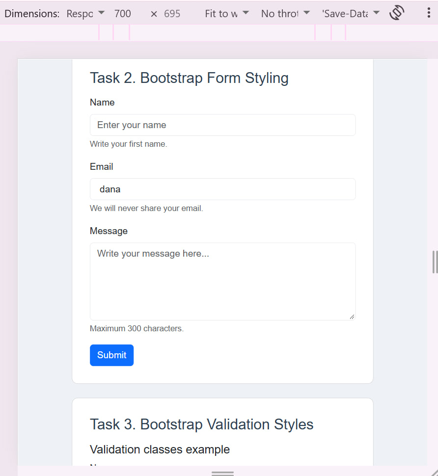

### Task 3. Bootstrap Validation Styles

First I showed is-valid and is-invalid classes with messages "Looks good!" and "Email is required.". Then I made a form with needs-validation and novalidate and added the script from Bootstrap documentation. After clicking submit the fields become green or red and messages appear under them.

is-valid and is-invalid example:

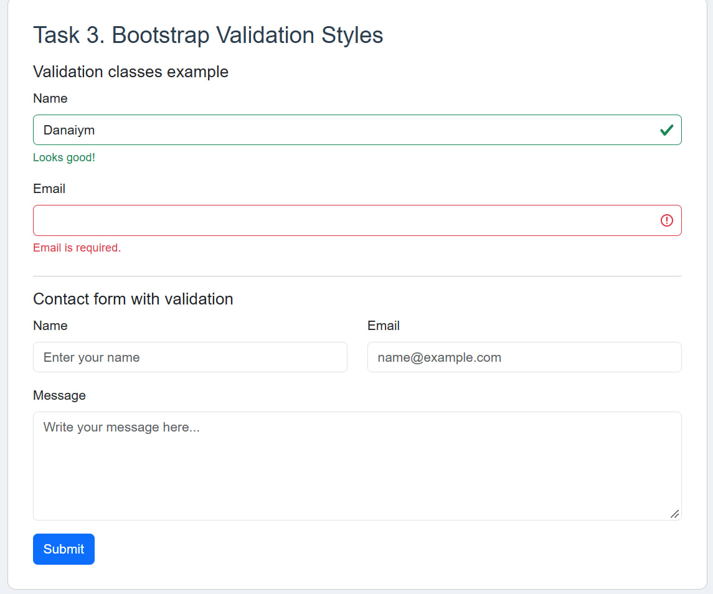

Wrong data:

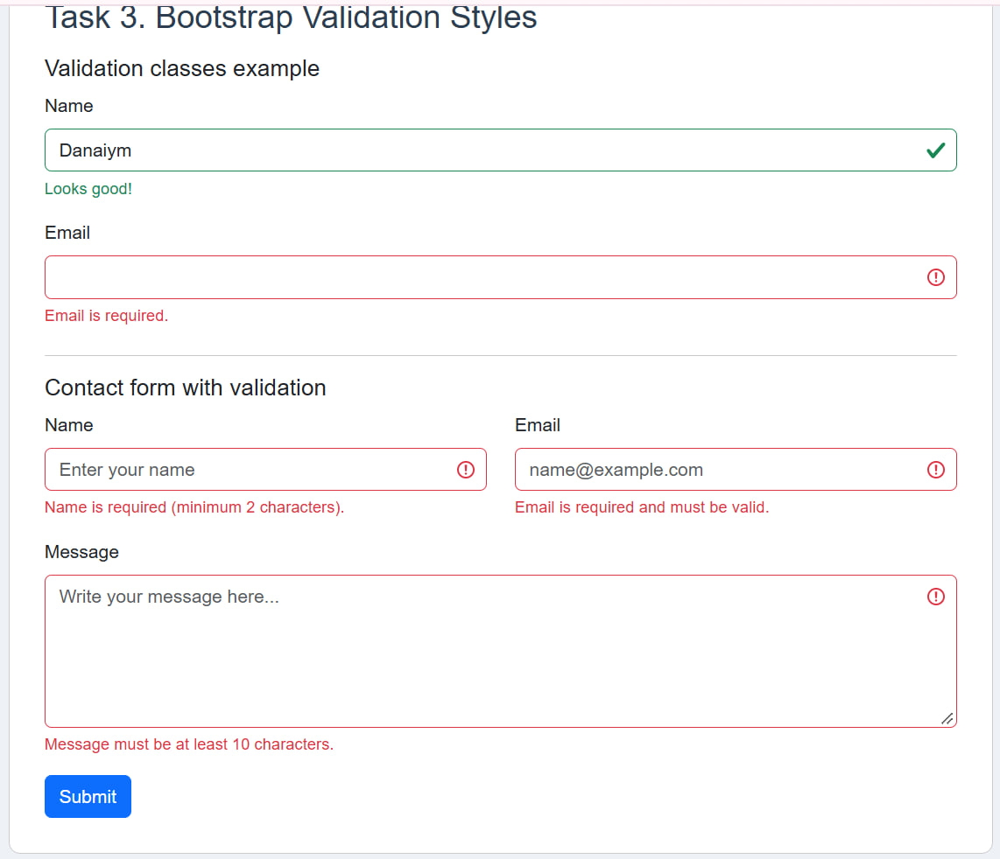

Correct data:

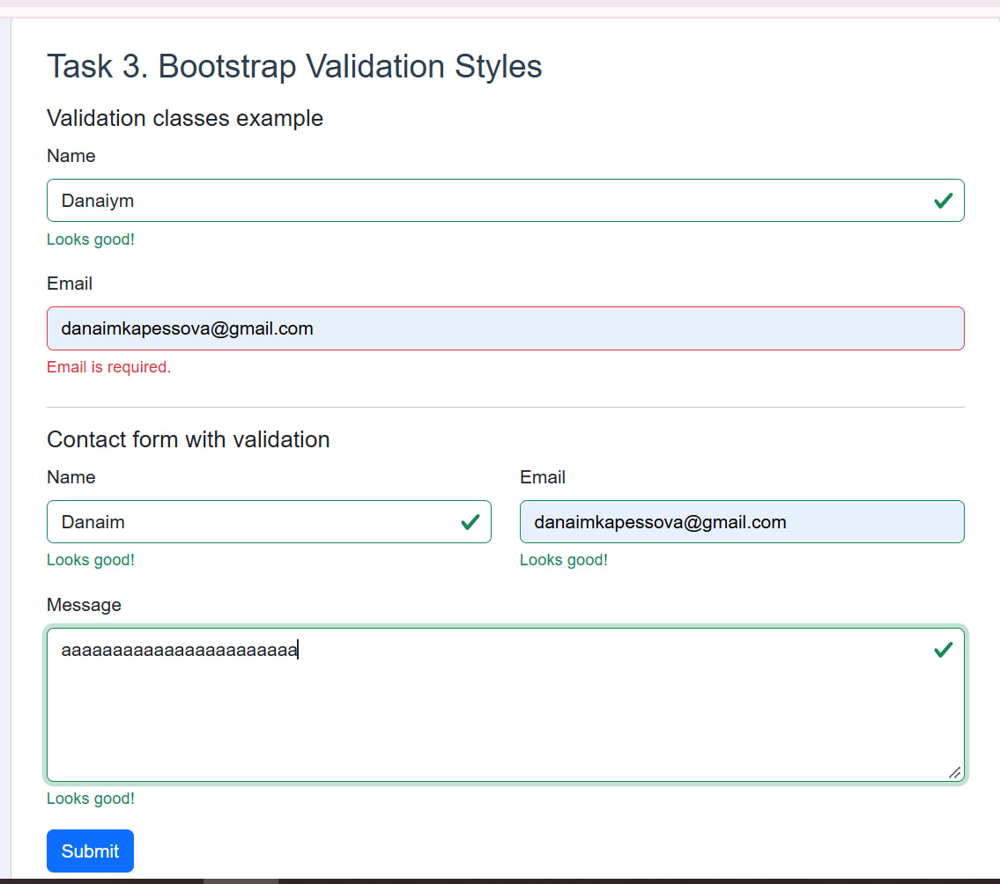

## Part 3. Advanced Form Project

### Task 4. Registration Form

I made a registration form with first name, last name, email, password, confirm password, gender (radio), hobbies (checkbox), country (select), submit and reset buttons. The form is responsive because of Bootstrap grid. Password must have minimum 8 characters. Bootstrap shows error and success messages.

Empty form after submit:

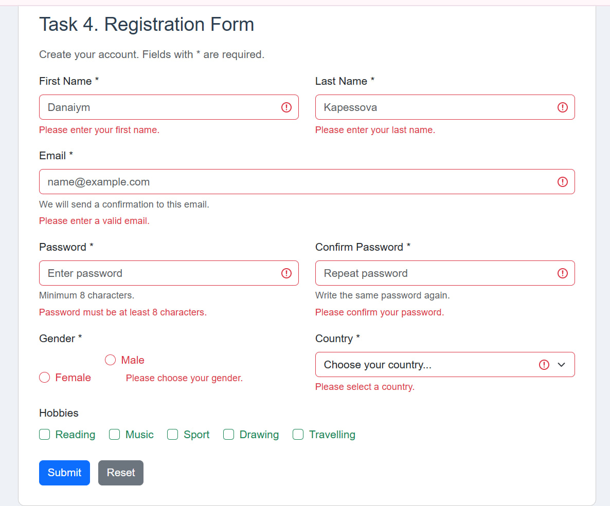

Filled form:

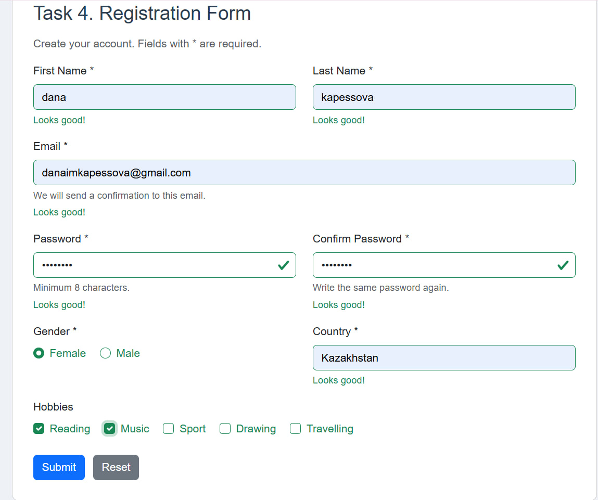

Mobile version:

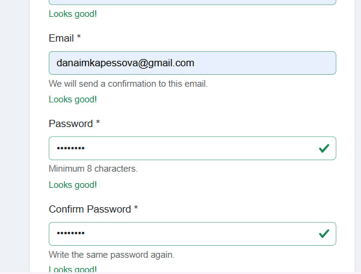

## Summary

In this assignment I learned how to make forms in HTML and how to check the data with HTML5 validation. Then I used Bootstrap to make forms look better and to be responsive. I also learned how Bootstrap validation works with is-valid, is-invalid, valid-feedback and invalid-feedback. At the end I made a registration form and tested it with correct and wrong data.